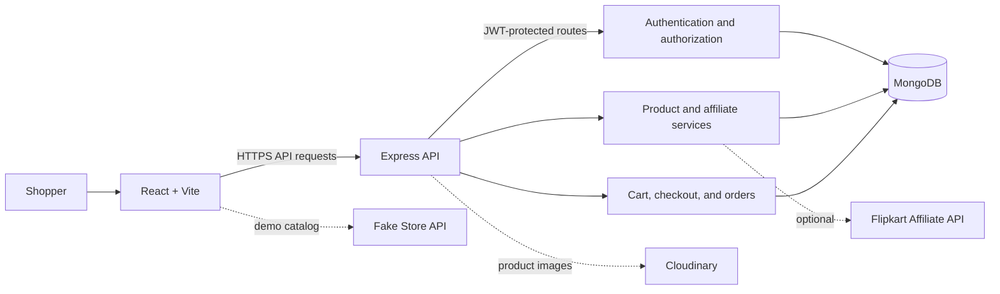
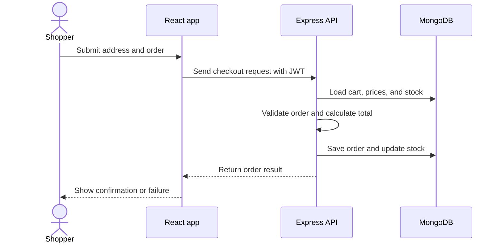

# E-Commerce System Design

## What the system does

This application is a React shopping website backed by an Express API and MongoDB. The browser sends API requests to the backend. The backend checks access, applies business rules, and reads or writes application data in MongoDB.

## How a request reaches the data

1. The browser loads the React app from the frontend host.
2. Vite embeds `VITE_SERVER_URL` into the app at build time. The app sends API requests to that backend origin.
3. Express checks the request origin against `CORS_ORIGINS`. In local development, it also allows the Vite origins on ports 5173 and 5174.
4. Public routes handle actions such as login and registration. Protected routes verify the JWT in the `Authorization` header and enforce customer or administrator access.
5. Controllers apply business rules and use Mongoose models to read or write MongoDB.
6. Express returns JSON. The frontend displays the result.

## Checkout flow

Production checkout currently supports Cash on Delivery. Card, UPI, and netbanking outcomes are development simulations; they do not charge money. Integrate a real payment provider and verified webhooks before offering online payments.

## Configuration by environment

| Setting | Local development | Production |
| --- | --- | --- |
| Frontend API URL | `http://localhost:8080` | Backend's public HTTPS origin |
| `CORS_ORIGINS` | Optional; Vite localhost origins are allowed | Exact frontend HTTPS origin(s), comma-separated |
| `NODE_ENV` | Omit or use `development` | `production` |
| `MONGODB_URI` | Local or Atlas database URI | Production database URI; allow the backend host in Atlas Network Access |
| `MONGODB_DATABASE` | Defaults to `ecommerce` | Set to the intended database name |
| `JWT_SECRET` | Private development secret | Random secret at least 32 bytes long |
| Payments | Demo simulations and COD | COD only until a real provider is integrated |

The production frontend build rejects a missing, local, non-HTTPS, or malformed API URL. The backend rejects invalid CORS entries and requires HTTPS origins in production. Do not commit `.env` files or put backend secrets in frontend variables.

## Deployment sequence

1. Deploy MongoDB and allow the backend host's outbound IP in Atlas Network Access.
2. Deploy the backend with `NODE_ENV=production`, `MONGODB_URI`, a strong `JWT_SECRET`, and `CORS_ORIGINS` set to the frontend's exact origin. Add Cloudinary and affiliate credentials if those features are needed.
3. Deploy the frontend with `VITE_SERVER_URL` set to the backend's HTTPS origin, then build the client.
4. Open the frontend and check `GET /health` on the API. A `200` response means MongoDB is connected; `503` means the database is unavailable.

## Current deployment limitation

The local backend did not start during the latest connection attempt because it could not reach its MongoDB Atlas cluster. The connection error recommends checking Atlas Network Access and network reachability. Resolve that before expecting API routes to work. The frontend and backend URLs are configured for local development as `http://localhost:8080`.
